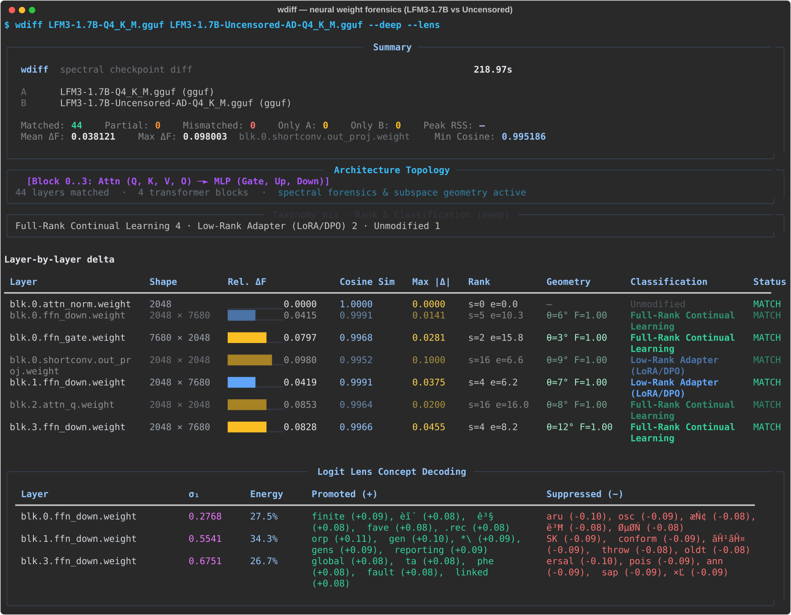
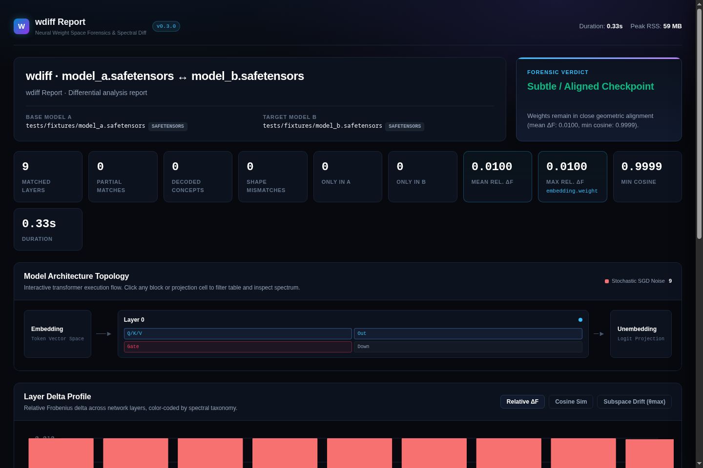
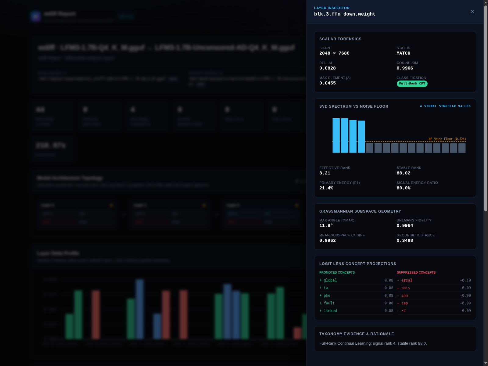
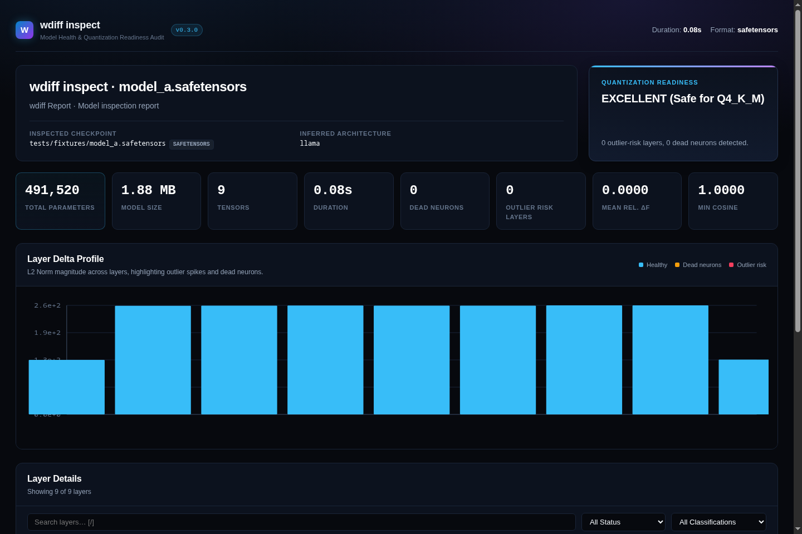

# `wdiff` (`weight-diff`) 🔬
### *git diff, but for neural network weights.*

[](https://pypi.org/project/weight-diff/)
[](https://www.python.org/downloads/)
[](LICENSE)
[](tests/)
[](#-memory-model--resource-bounds)
[](#)

```bash
pip install weight-diff
wdiff modelA.safetensors modelB.gguf --deep --lens --report diff_report.html
```

**`wdiff`** is an ultra-fast, memory-bounded CLI and visual forensics analyzer for Large Language Model weights (`.safetensors`, sharded indices, and `.gguf` quantizations).

When comparing fine-tuned, pruned, abliterated, or merged checkpoints, standard benchmark evaluations (MMLU, GSM8K) are slow, non-deterministic, and cannot explain *what mechanically altered inside the matrices*. `wdiff` streams through raw checkpoint tensors on CPU, performing:

- **Exact Weight Drift**: Relative Frobenius norm ($\Delta F$), cosine similarity, $L_\infty$, and $L_1$ metrics.
- **Spectral Decomposition & Random Matrix Theory (`--deep`)**: Separates true structural updates from stochastic SGD noise via Marcenko-Pastur edge thresholds.
- **Grassmannian Subspace Geometry**: Measures principal angles ($\theta_1 \dots \theta_k$), geodesic/chordal distance, and Uhlmann state fidelity between feature representations.
- **Static Semantic Logit Lens (`--lens`)**: Multiplies weight delta singular vectors directly through the unembedding matrix ($W_U$) to decode which plain-English concepts the fine-tune promoted or suppressed — **with zero forward passes and zero GPU runtime**.
- **Cross-Format Parity**: Automatically deinterleaves GGML rotational coordinates to match Hugging Face split-half RoPE layouts.
- **Standalone Interactive HTML Dashboards (`--report`)**: Generates self-contained interactive reports with embedded SVG profile charts, live search, and zero external network requests.

---

## 🖥️ Visual Tour

### 1. Terminal Forensics Interface (Rich TUI)
High-resolution terminal output on real models (`LFM3-1.7B` Base vs `LFM3-1.7B-Uncensored`), featuring an ASCII/Unicode **Transformer Architecture Topology flow**, relative delta distribution heatbars, spectral taxonomy classifications (`Full-Rank Continual Learning`, `LoRA Adapter`, `SGD Noise`), and **Logit Lens Concept Decoding** projecting top singular vectors directly into vocabulary space to detect promoted and suppressed token concepts:



### 2. Standalone Interactive HTML Report (`--report`)
Self-contained single-file HTML reports on real model checkpoints featuring an **Interactive Transformer Architecture Topology Map**, multi-view **Spectral Landscape Charts**, live search & multi-filtering, and a slide-over **Layer Inspector Drawer** with SVD eigenvalue decay against Marchenko-Pastur noise floors, Grassmannian subspace geometry, and semantic logit lens cards. Completely air-gapped with zero remote CDN or external font dependencies:



*Clicking any layer in the topology map or table opens the Slide-Over Forensic Inspector with Marchenko-Pastur spectral plots, Grassmannian subspace angles, and Logit Lens token decodings:*



### 3. Single-Model Health & Quantization Readiness (`wdiff inspect`)
Real-world audit of `SmolLM2-360M-Instruct (Q8_0)` checking dead neurons, feature outlier spikes, and 4-bit quantization collapse risk in seconds with interactive norm distribution charts:



---

## 🚀 Installation & Quickstart

The package is published on PyPI as **`weight-diff`** (the executable binary is invoked as **`wdiff`**):

### Using `pip` or `uv`
```bash
# Recommended: Install into user environment
pip install weight-diff

# Or run instantly via uv without permanent installation
uvx --from weight-diff wdiff modelA.safetensors modelB.safetensors

# Or install as an isolated tool
uv tool install weight-diff
```

### Install from Source
```bash
git clone https://github.com/Aayushbankar/wdiff.git
cd wdiff
uv sync --extra dev
uv run wdiff --help
```

---

## 💡 Practical Workflows & Examples

### 1. Differential Autopsy (Base vs Uncensored / Fine-Tuned)
Inspect what changed between a base model and its fine-tuned or abliterated successor:
```bash
wdiff Llama-3-8B.safetensors Llama-3-8B-Instruct.safetensors --deep --lens
```
*Detects whether safety guardrails were removed via Rank-1 abliteration or broad multi-rank continual learning, decoding suppressed tokens (e.g. `prohibited`, `unfortunately`, `impossible`).*

### 2. Cross-Format Diffing (Hugging Face SafeTensors vs Quantized GGUF)
Diff an unquantized FP16 checkpoint against a quantized `Q4_K_M` or `Q8_0` GGUF file:
```bash
wdiff model_fp16.safetensors model_q4_k_m.gguf --deep
```
*`wdiff` automatically matches layer names across naming conventions, reverses GGUF Fortran memory ordering, dequantizes on the fly, and applies RoPE coordinate parity.*

### 3. Virtual LoRA Adapter Inspection (`--lora`)
Compare a base model against a virtual LoRA adapter ($W_0 + \frac{\alpha}{r} B A$) without merging files to disk:
```bash
wdiff base_model.safetensors --lora adapter.safetensors --deep --lens
```
*Automatically parses `adapter_config.json` for rank $r$ and $\alpha$, applying exact PEFT scaling.*

### 4. Single-Model Health Audit (`wdiff inspect`)
Check an unknown or hand-merged model for structural corruption before deployment:
```bash
wdiff inspect merged_model.safetensors --deep
```
*Scans for dead rows/columns ($L_2 < 10^{-7}$), computes Dettmers feature outlier scores, and estimates quantization readiness.*

### 5. Generate Shareable HTML Reports
```bash
wdiff modelA.safetensors modelB.safetensors --deep --lens --report report.html
```

### 6. Pipeline Automation via JSON Output
```bash
wdiff modelA.safetensors modelB.safetensors --deep --json | jq '.summary'
```

---

## 🔬 Core Forensic Capabilities

### 1. Spectral Analysis & Random Matrix Theory
`wdiff` decomposes weight deltas $\Delta W = W_B - W_A$ using randomized SVD (Halko-Martinsson-Tropp with intermediate QR orthonormalization). To determine whether a weight shift represents intentional signal or stochastic training noise, it computes the theoretical **Marcenko-Pastur bulk noise edge**:

$$s_+ = \hat{\sigma} \left(\sqrt{m} + \sqrt{n}\right)$$

where $\hat{\sigma}$ is estimated using the robust median absolute deviation ($\text{MAD} / 0.6745$). Singular values $\sigma_i > 1.01 \cdot s_+$ are categorized as true **signal rank**.

### 2. Grassmannian Subspace Geometry
Beyond raw magnitude drift, `wdiff` analyzes the rotation of top-$k$ feature subspaces on the Grassmannian manifold $\text{Gr}(k, m)$:
- **Principal Angles** ($\theta_1 \le \dots \le \theta_k$): Computed via SVD of the subspace overlap matrix $M = U_A^T U_B$.
- **Chordal Distance**: $d_{\text{chord}} = \sqrt{k - \|U_A^T U_B\|_F^2}$.
- **Geodesic Distance**: $d_{\text{geo}} = \sqrt{\sum_{i=1}^k \theta_i^2}$.
- **Uhlmann State Fidelity**: Quantum transition fidelity $\mathcal{F}(\rho_A, \rho_B) \in [0, 1]$ across low-rank states.
- **Drift Warning**: Layers with $\theta_{\max} > 25^\circ$ indicate representation drift rather than pure gain scaling.

### 3. Static Semantic Logit Lens
For down-projection layers ($W_{\text{down}}$), `wdiff` extracts the primary singular vector $u_1$ of $\Delta W$ and projects it into vocabulary logit space through the model's unembedding matrix $W_U$:

$$\text{logits} = W_U \cdot u_1$$

Using chunked matrix multiplication ($4096$ rows per chunk) and min-heaps, `wdiff` decodes the top-$k$ positive (promoted) and negative (suppressed) semantic concepts in $<70$ MB RAM without executing model inference.

### 4. RoPE Coordinate Parity
Hugging Face splits RoPE coordinates into two halves $[x_0, \dots, x_{d/2-1}]$ and $[x_{d/2}, \dots, x_{d-1}]$, whereas GGML / GGUF interleaves them as pairs $[(x_0, x_1), (x_2, x_3), \dots]$. Comparing cross-format weights naively yields false divergence. `wdiff` automatically detects RoPE projection layers and applies adaptive coordinate deinterleaving:

$$\text{deinterleave}: [n_{\text{heads}}, d_{\text{head}}/2, 2] \xrightarrow{\text{swapaxes}} [n_{\text{heads}}, 2, d_{\text{head}}/2]$$

### 5. Automated Forensic Taxonomy
Every layer delta is automatically classified into one of 6 structural categories:

| Forensic Badge | Detection Criteria | Mechanical Meaning |
|---|---|---|
| `Unmodified` | $\Delta F < 10^{-6}$ and $\max|\Delta| < 10^{-7}$ | Parameter tensors are identical. |
| `Surgical Rank-1 Ablation` | Primary Energy $> 90\%$ and $\text{rk}_{\text{st}} \le 1.35$ | Targeted direction zeroed out (e.g. Arditi et al. refusal abliteration). |
| `Low-Rank Adapter (LoRA/DPO)` | $2 \le r_{\text{signal}} \le 64$ and $\text{rk}_{\text{st}} \le 40$ | Parameter update constrained to low-rank subspace. |
| `Sparse Update (TIES/DARE)` | Sparsity $\ge 65\%$ ($|\Delta W| < 10^{-7}$) | Sparse pruning, fine-tune mask, or delta merging. |
| `Full-Rank Continual Learning` | High signal rank and distributed energy | Unconstrained full-rank gradient updates across parameter space. |
| `Stochastic SGD Noise` | $r_{\text{signal}} == 0$ | Perturbation lies entirely within the Marcenko-Pastur noise bulk. |

---

## 📊 Real-World Benchmark Results

Benchmarks run across **19.6 Billion parameters** on standard consumer CPU hardware (x86_64, Linux):

| Model Architecture | Size | Parameter Count | Tensors | Time | Throughput | Dead Neurons | Outlier Layers |
| :--- | :--- | :--- | :--- | :--- | :--- | :--- | :--- |
| **SmolLM2-360M-Instruct (Q8_0)** | 368.5 MB | 361,821,120 | 290 | 7.02s | **51.5 M param/s** | 0 | 219 |
| **SmolLM2-1.7B-Instruct (Q4_K_M)** | 1,006.7 MB | 1,711,376,384 | 218 | 28.05s | **61.0 M param/s** | 0 | 192 |
| **Qwen2.5-1.5B-Instruct (Q4_K_M)** | 1,065.6 MB | 1,777,088,000 | 339 | 36.10s | **49.2 M param/s** | 1 | 282 |
| **Qwen2.5-Coder-3B-Instruct (Q4_K_M)** | 1,840.5 MB | 3,085,938,688 | 434 | 60.07s | **51.4 M param/s** | 0 | 337 |
| **Qwen3.5-4B-3D-Coder (Q4_K_M)** | 2,583.3 MB | 4,205,751,296 | 426 | 81.59s | **51.5 M param/s** | 0 | 296 |
| **K2-Horizon-4B (Q4_K_M)** | 3,010.4 MB | 5,058,255,360 | 327 | 92.35s | **54.8 M param/s** | 741 | 240 |
| **LFM3-1.7B Base (Q4_K_M)** | 1,048.7 MB | 1,728,801,600 | 287 | 34.92s | **49.5 M param/s** | 60 | 228 |
| **LFM3-1.7B Uncensored (Q4_K_M)** | 1,079.8 MB | 1,728,801,600 | 287 | 36.06s | **47.9 M param/s** | 60 | 228 |
| **SD-v1.5 VAE Decoder (SafeTensors)** | 9.3 MB | 2,445,063 | 134 | 0.11s | **21.3 M param/s** | 0 | 50 |

*(See detailed methodology and real-world abliteration case studies in [`benchmarks/BENCHMARK_REPORT.md`](benchmarks/BENCHMARK_REPORT.md))*

---

## 🧠 Memory Model & Resource Bounds

`wdiff` guarantees that **anonymous heap consumption** scales with the size of the largest single tensor, not total model size:

$$\text{Heap Peak} \approx 2 \times T_{\max} + \mathcal{O}(1)$$

For a standard 7B model where the largest single MLP tensor is $\approx 235$ MB, anonymous heap is bounded to $\approx 1.1$ GB.

> [!NOTE]
> **Process RSS vs Anonymous Heap**: While heap memory is bounded by the largest active tensor pair, the OS process Resident Set Size (RSS) will include pages cached by the Linux kernel's virtual memory subsystem from `mmap` checkpoint reads. Total process RSS on 1.7B GGUF models typically measures $\approx 4.3$ GB during a complete deep diff run.

---

## 📖 CLI Flag Reference

| Option | Flag | Description | Default |
|---|---|---|---|
| Filter | `-f`, `--filter REGEX` | Regex pattern matching tensor names (e.g. `blk\.0\.attn`) | `None` |
| Deep Spectral | `--deep` | Enables randomized SVD, Marcenko-Pastur noise floor, and taxonomy | `False` |
| Concept Lens | `--lens` | Decodes semantic concept directions on down-projection layers | `False` |
| LoRA Adapter | `--lora PATH` | Path to LoRA adapter (`.safetensors`) to fold onto `model_a` | `None` |
| LoRA Scale | `--lora-scale FLOAT` | Global scaling factor multiplier for LoRA adapter | `1.0` |
| HTML Report | `--report PATH` | Path to export self-contained interactive HTML dashboard | `None` |
| JSON Output | `--json` | Stream machine-readable JSON metrics to stdout | `False` |
| Tokenizer Path | `--tokenizer PATH` | Path to `tokenizer.json` or directory for vocabulary lookup | Auto-discovered |
| Lens Top-K | `--lens-top-k INT` | Number of positive/negative concept tokens per layer | `5` |
| RoPE Parity | `--no-rope-parity` | Disable automatic RoPE deinterleaving for cross-format diffs | `False` |
| Version | `-v`, `--version` | Display version and exit | — |

---

## 🐍 Python API

In addition to the CLI, `wdiff` can be embedded directly into Python pipelines:

```python
from wdiff.engine.diff import diff_models
from wdiff.display.report import generate_html_report

# Perform differential analysis
result = diff_models(
    "model_a.safetensors",
    "model_b.safetensors",
    deep=True,
    lens=True,
)

print(f"Matched {result.summary.matched_count} layers")
print(f"Mean Frobenius Delta: {result.summary.mean_frobenius:.6f}")
print(f"Max Drift Layer: {result.summary.max_frobenius_tensor}")

# Export standalone report
generate_html_report(result, "audit_report.html")
```

---

## 📚 Technical Documentation & Deep Dives

- [**Technical Architecture & Streaming Buffers**](docs/ARCHITECTURE.md): Memory maps, chunked accumulation, and protocol design.
- [**Tensor Naming & Canonicalization**](docs/learning/01_TENSOR_NAMING_CANONICALIZATION.md): Regex mapping tables across LLaMA, Qwen2, Gemma, Gemma2, and Phi-3.
- [**Random Matrix Theory & Noise Floors**](docs/learning/03_RANDOM_MATRIX_THEORY_NOISE_FLOOR.md): Mathematical derivations of the Marcenko-Pastur distribution.
- [**Grassmannian Subspace Geometry**](docs/learning/04_SUBSPACE_ANGLES_AND_GEOMETRY.md): Principal angles and Uhlmann fidelity proofs.
- [**Engineering Errors & Fixes Ledger**](docs/ERRORS_AND_FIXES.md): Forensic log of all 23 historical bugs and mitigations.
- [**Development Roadmap**](docs/ROADMAP.md): Milestone tracker and roadmap.

---

## ⚖️ License

MIT License. See [LICENSE](LICENSE) for details.
